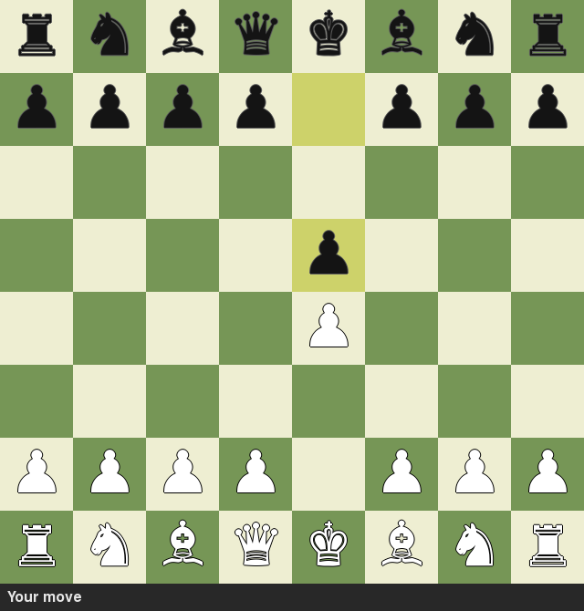

# python-chess-engine

[](https://github.com/mike200004/python-chess-engine/actions/workflows/tests.yml)

A small chess engine written from scratch in pure Python: legal move
generation, alpha-beta search, a pygame board to play against it, and UCI
support so it can be loaded into a real chess GUI.

It's an amateur engine. In a few seconds it searches about 5 plies (half-moves)
deep in the opening and 6–8 in simpler positions, so it plays sensible,
tactical chess and spots short mates, but any club player will beat it.



## How I learned

I learned the basics from Eddie Sharick's YouTube series
[**Creating a Chess Engine in Python**](https://www.youtube.com/playlist?list=PLBwF487qi8MGU81nDGaeNE1EnNEPYWKY_).
It builds a playable chess game in pygame step by step: drawing the board,
representing the game state, generating moves (then handling checks, pins,
castling, en passant and promotion), and finally an AI that goes from random
moves to minimax, negamax and alpha-beta pruning.

This project follows the same overall plan (a pygame board on top of a
negamax/alpha-beta engine), but the engine itself is built differently:

| Topic | In the series | In this project |
|---|---|---|
| Board | 8×8 list of strings like `"wN"` | 10×12 "mailbox" list of ints, so pieces can step off the edge into sentinel squares without bounds checks |
| Legal moves | Track checks and pins directly | Generate pseudo-legal moves, make each one, discard it if it leaves the king in check (simpler to get right) |
| Making sure moves are right | Playing the game | **Perft** tests against published node counts, plus make/unmake round-trip tests |
| Search | Negamax with alpha-beta at a fixed depth | Adds iterative deepening with a time limit, quiescence search, move ordering (MVV-LVA, killer moves), a transposition table with Zobrist hashing, and check extensions |
| Evaluation | Material + piece position scores | Material + the "Simplified Evaluation Function" tables, with a separate endgame king table and a bishop-pair bonus |
| Interface | pygame | pygame **and** UCI, so it runs in Arena, Cute Chess, En Croissant, etc. |

Other resources I used:

- [Chess Programming Wiki](https://www.chessprogramming.org/): the
  [10x12 board](https://www.chessprogramming.org/10x12_Board),
  [perft results](https://www.chessprogramming.org/Perft_Results),
  [quiescence search](https://www.chessprogramming.org/Quiescence_Search),
  [MVV-LVA](https://www.chessprogramming.org/MVV-LVA),
  [Zobrist hashing](https://www.chessprogramming.org/Zobrist_Hashing),
  [Simplified Evaluation Function](https://www.chessprogramming.org/Simplified_Evaluation_Function)
- The [UCI protocol description](https://backscattering.de/chess/uci/)

## Running it

Needs Python 3.10+. The engine has no dependencies; the board window needs
[pygame-ce](https://pyga.me/) (a maintained fork of pygame that also installs
on newer Pythons).

```bash
git clone https://github.com/mike200004/python-chess-engine.git
cd python-chess-engine
pip install -e ".[gui]"

python -m chess_engine gui              # play white in a window
python -m chess_engine gui --black      # play black
python -m chess_engine play             # play in the terminal (moves like e2e4)
python -m chess_engine                  # UCI mode, for chess GUIs
```

In the window: click a piece, then a highlighted square. **U** undoes your
last move, **R** starts a new game, **F** flips the board. Pawns always
promote to a queen when you play in the window.

**Using it in a chess GUI:** add a new UCI engine and point it at a small
script containing `python -m chess_engine` (or the `chess-engine` command
that `pip install` creates).

```
> position startpos moves e2e4 e7e5
> go movetime 2000
info depth 1 score cp 50 nodes 58 nps 126903 time 0 pv b1c3
info depth 2 score cp 0 nodes 282 nps 74137 time 3 pv b1c3 b8c6
info depth 3 score cp 50 nodes 2289 nps 128556 time 17 pv b1c3 b8c6 g1f3
info depth 4 score cp 0 nodes 11043 nps 78144 time 141 pv b1c3 b8c6 g1f3 g8f6
info depth 5 score cp 40 nodes 67385 nps 119968 time 561 pv b1c3 b8c6 g1f3 g8f6 d2d4
bestmove b1c3
```

## How it works

```
chess_engine/
  board.py     board, FEN, move generation, make/unmake, perft
  evaluate.py  material + piece-square tables
  search.py    iterative deepening negamax with alpha-beta
  uci.py       UCI protocol (search runs in a thread so "stop" works)
  gui.py       pygame board
  __main__.py  command line: gui / play / uci / perft / bench
```

**Board.** The 8×8 board sits inside a 120-square list (`a1` = 21,
`h8` = 98) with a border of off-board sentinels. A knight on the edge can add
its offsets and just land on a sentinel. Pieces are ints (`+` white,
`-` black), and every move is undoable: `make_move` pushes what it needs onto
a stack and `unmake_move` pops it, so the search never copies the board.

**Move generation.** Moves are generated as if pins and checks didn't exist,
then each one is played and thrown away if it leaves the king attacked.
`is_attacked` looks outward from a square for each piece type, which is also
used for check detection and castling through check.

**Search.** Negamax with alpha-beta pruning, run with iterative deepening
(depth 1, 2, 3, ... until time runs out). At depth 0 it switches to a
quiescence search that keeps looking at captures, so it doesn't evaluate a
position in the middle of a trade. Good moves are tried first (previous best
move, then captures ordered by most valuable victim / least valuable
attacker, then "killer" moves that caused cutoffs at the same depth), which is
what makes alpha-beta prune well. A transposition table, keyed by an
incrementally updated Zobrist hash, remembers positions it has already
searched.

**Evaluation.** Material plus a bonus or penalty for where each piece
stands (knights in the centre, rooks on the 7th, king tucked away in the
middlegame but central in the endgame).

## Testing

```bash
pip install -e ".[dev]"
pytest                    # ~1 s
SLOW_TESTS=1 pytest       # adds deeper perft
python -m chess_engine perft 4
python -m chess_engine bench
```

- **Perft:** counts every legal move sequence to a fixed depth and compares
  with the published numbers for six standard test positions, including
  "Kiwipete", which is full of castling, en passant, promotion and pin edge
  cases. One wrong move anywhere changes the count.
- **Make/unmake:** plays every move two plies deep from several positions
  and checks the board and hash are restored exactly, and that the
  incrementally updated hash always equals one computed from scratch.
- **Search:** finds mate in 1 and mate in 2, wins a hanging queen, doesn't
  grab a defended pawn with a rook, avoids stalemating when winning, respects
  the time limit.
- **UCI:** runs the engine as a subprocess and talks to it like a GUI would.

## Limitations

- Speed: roughly 80,000–140,000 positions/second on a MacBook with Python 3.14, which is slow next to
  engines in C or Rust (millions per second). That's the price of pure
  Python and readable code.
- No opening book or endgame tablebases, and no null-move pruning or late
  move reductions, so it doesn't search as deep as it could.
- Quiescence search only looks at captures and queen promotions, not
  checks, so it can miss some forcing lines. (It does notice when a
  capture is checkmate.)
- Strength hasn't been measured properly. It beats a random-move player
  every time, but it has no Elo rating.

## License

MIT
